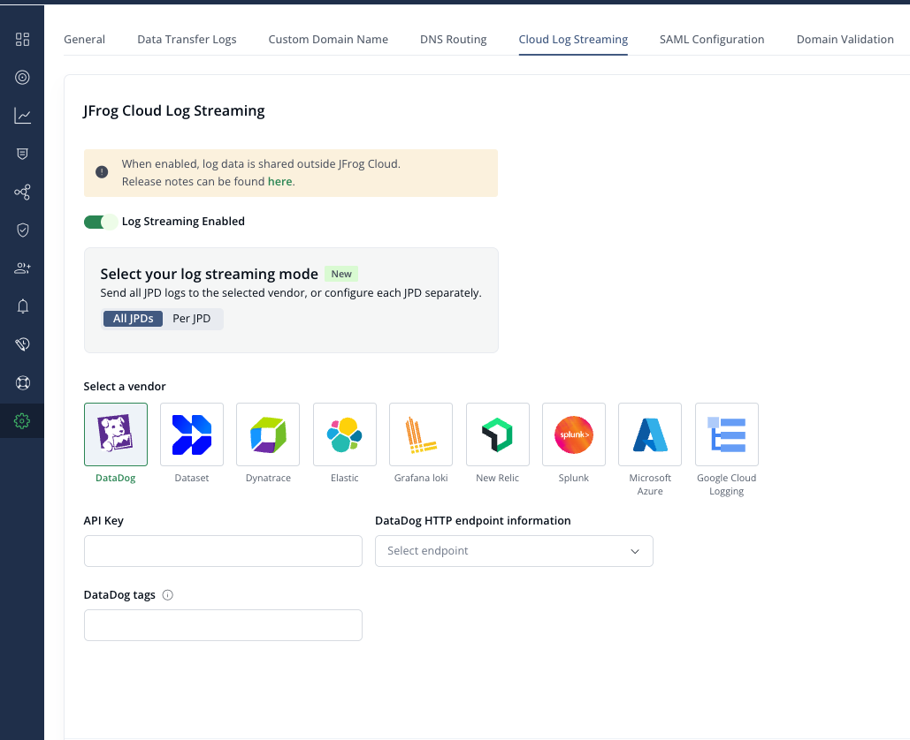
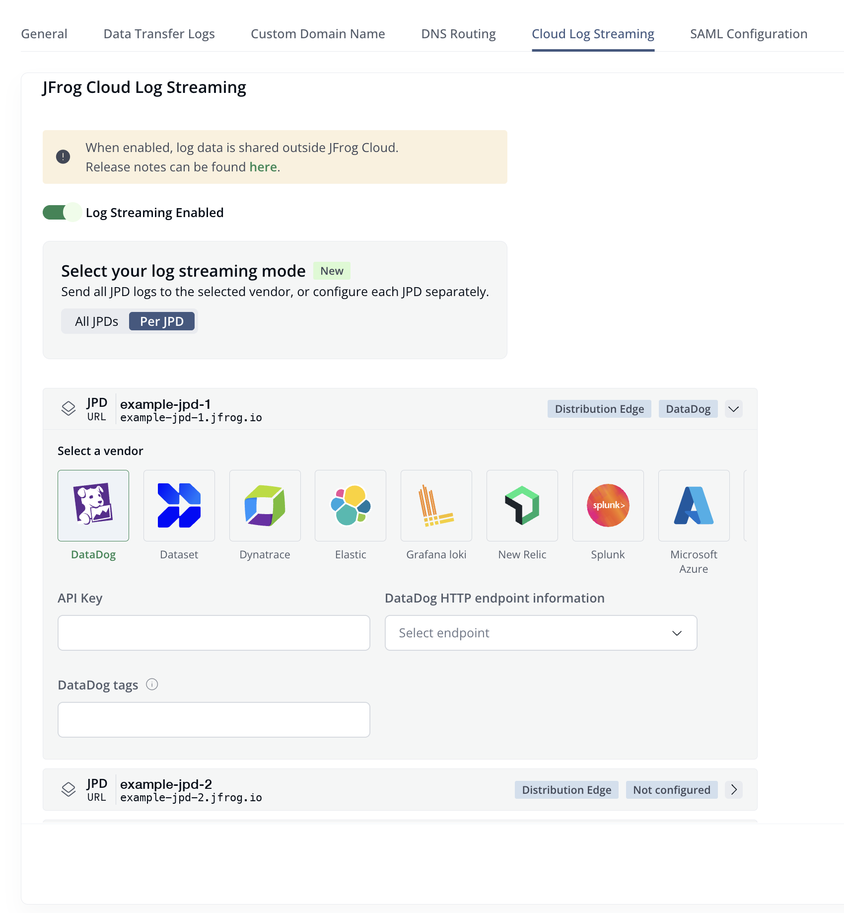

## Set up Cloud Log Streaming with Datadog

Perform the following steps to set up log streaming with Datadog.

1. Fetch **Datadog API key** from the [Organization Settings](https://app.datadoghq.com/organization-settings/api-keys) page in Datadog.
For more information, refer to the [Datadog documentation](https://docs.datadoghq.com/account_management/api-app-keys/).

2. Identify your **Datadog URL** based on the location as listed in the [table](https://docs.datadoghq.com/getting_started/site/#access-the-datadog-site) in Datadog documentation.

3. Form a key-value pair of any additional parameters that you need to add to the logs in the following format:
```
key1:value1,key2:value2
```
For example, `env:staging,version:5.1.`

4. Go to the [MyJFrog Portal](http://my.jfrog.com/).
5. Additionally, you can access the MyJFrog Portal from the JFrog Platform. For more information, see [Platform Single Sign-On to MyJFrog](https://jfrog.com/help/r/5H19DEVA7PsahAXH0xXNSg/_iPFuW3rDQk_mlAk9URBkQ).

> Note: You must be a Platform Admin to access the MyJFrog Portal via the JFrog Platform.

Log into the JFrog Platform, and in the left navigation bar of the **Application** module, click **MyJFrog Portal**.
This opens the **MyJFrog Portal** in a new tab in your browser.

6. Select **Settings** from the left navigation menu.

7. Select the **JFrog Cloud Log Streaming** tab.

8. Turn on the **Log Streaming** toggle.

> Note: If your account has the **Per JPD** feature, the **Select your log streaming mode** section appears below the toggle. If not, the vendor list appears there instead. Start at step 2 of **Option A**.

9. Choose **Option A** or **Option B**.

* **Option A: All JPDs** sends logs from every JPD to a single destination.
* **Option B: Per JPD** sends the logs of each JPD to its own destination. Different JPDs can use different vendors.

#### Option A: All JPDs

1. Select **All JPDs**.

2. Select **DataDog**.



3. Enter the Datadog API key in the **API Key** field. Select your Datadog URL from the **DataDog HTTP endpoint information** list.

4. Enter the key-value pair that you formed in the **DataDog tags** field.

5. Click **Save**.

#### Option B: Per JPD

1. Select **Per JPD**.



2. Expand the JPD you want to configure.

3. Select **DataDog**.

4. Enter the **API Key**, select the **DataDog HTTP endpoint information**, and enter the **DataDog tags** for this JPD.

5. Repeat steps 2–4 for each JPD you want to configure. Empty JPDs stay **Not configured**.

6. Click **Save All**.

> Note: If a JPD has a vendor but not all required fields, **Save All** stays disabled. Hover over **Save All** to see which JPDs need more information.

> Note: When you switch to **Per JPD**, MyJFrog fills each JPD that has no saved settings with the **All JPDs** settings. MyJFrog saves these values only when you click **Save All**. Check each JPD before you click **Save All**.

> [!WARNING]
> When you switch back to **All JPDs**, a **Switch to All JPDs?** dialog appears if any JPD has its own settings. To continue, select the confirmation checkbox and click **Discard & switch**. MyJFrog then permanently deletes the per-JPD settings.

#### Example dashboard

The example dashboard will be installed together with the [JFrog Cloud integration](https://docs.datadoghq.com/integrations/jfrog_platform_cloud/), which can be found in the Integrations menu in Datadog.