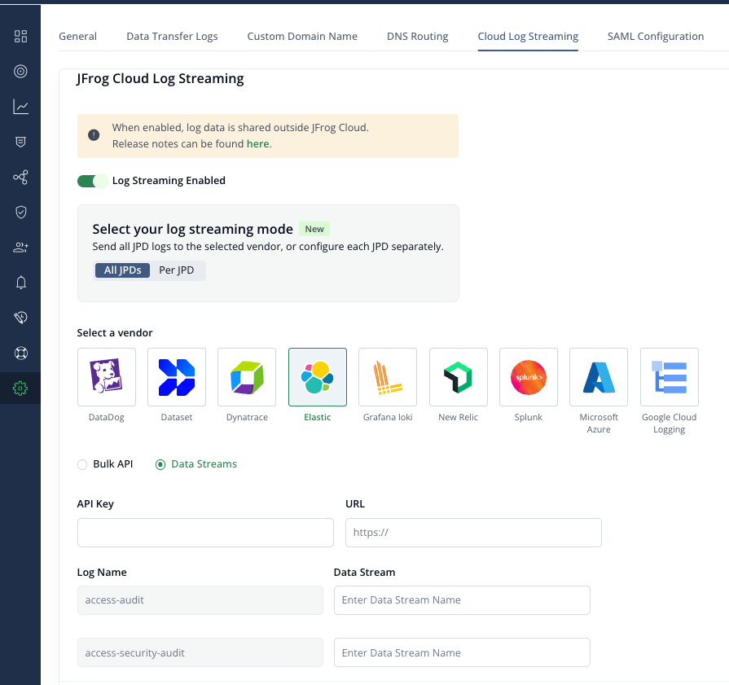
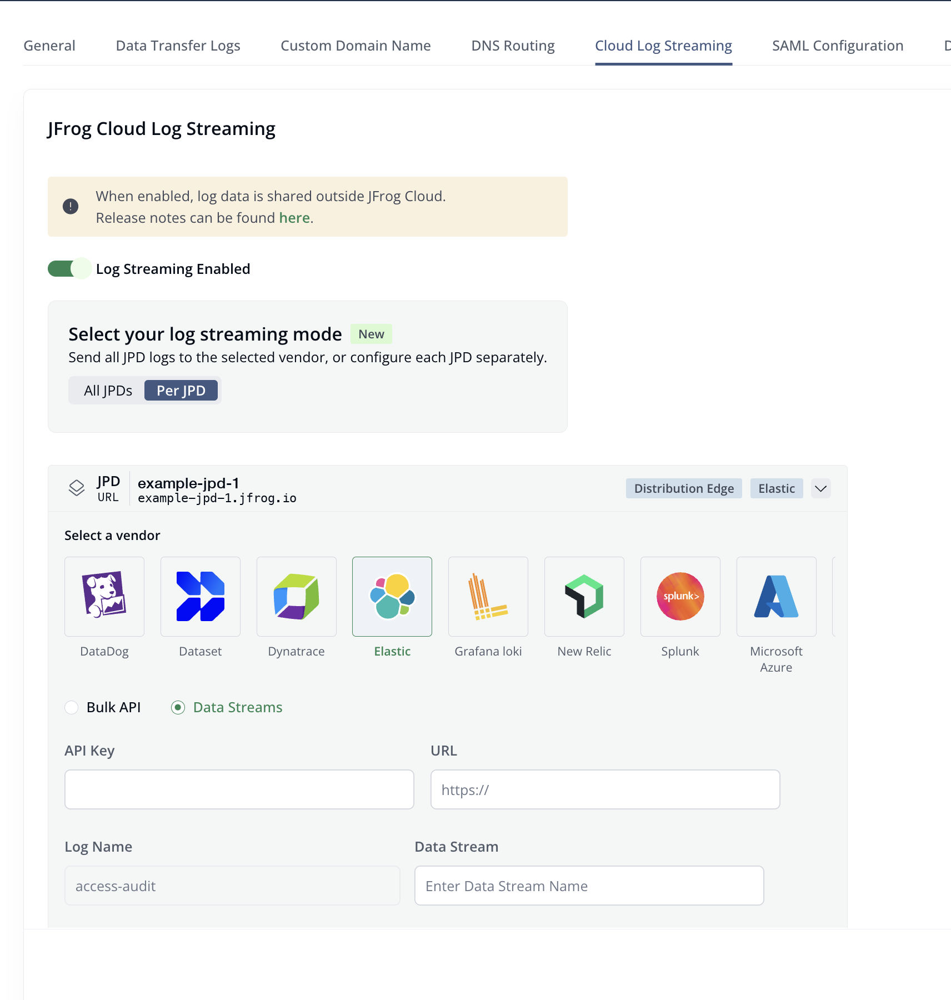

## Set up Cloud Log Streaming with Elastic Data Streams

Perform the following steps to set up log streaming with Elastic.

1. Generate a new API key in [Elastic](https://www.elastic.co/guide/en/kibana/current/api-keys.html).
   Api key should have following privileges:

```
"cluster": [
        "manage_index_templates",
        "monitor"
      ],
"indices": [
  {
    "names": ["<data-stream-name>*"],
    "privileges": [
      "create_index",
      "write",
      "read",
      "manage",
      "auto_configure"
    ]
  }
]
```
For more information, see [Elasticsearch privileges](https://www.elastic.co/docs/deploy-manage/users-roles/cluster-or-deployment-auth/elasticsearch-privileges).
>Note: Replace `<data-stream-name>` with the actual name of your data stream and please add all the data streams as part of the privileges.
2. Go to the [MyJFrog Portal](http://my.jfrog.com/).

3. Additionally, you can access the MyJFrog Portal from the JFrog Platform. For more information, see [Platform Single Sign-On to MyJFrog](https://jfrog.com/help/r/5H19DEVA7PsahAXH0xXNSg/_iPFuW3rDQk_mlAk9URBkQ).

> Note: You must be a Platform Admin to access the MyJFrog Portal via the JFrog Platform.

Log into the JFrog Platform, and in the left navigation bar of the **Application** module, click **MyJFrog Portal**.
This opens the **MyJFrog Portal** in a new tab in your browser.

4. Select **Settings** from the left navigation menu.

5. Select the **JFrog Cloud Log Streaming** tab.

6. Turn on the **Log Streaming** toggle.

> Note: If your account has the multi-JPD (**Per JPD**) feature, the **Select your log streaming mode** section appears below the toggle. It shows **All JPDs** and **Per JPD**.
> If your account does not have this feature, the vendor list appears directly below the toggle. In this case, follow **Option A** and skip its step 1.

7. Follow **Option A** or **Option B**.

* Use **Option A: All JPDs** to send logs from every JPD to 1 destination.
* Use **Option B: Per JPD** to give each JPD its own destination.

#### Option A: All JPDs

1. Select **All JPDs**.

2. Select **Elastic**.

3. Select **Data Streams**.



4. Enter the **Elastic API key** and log ingestion URL in format `http://localhost:9200` and write the data stream names.

5. Click **Save**.

#### Option B: Per JPD

1. Select **Per JPD**.



2. Expand the row of the JPD that you want to configure.

3. Select **Elastic**.

4. Select **Data Streams**.

5. Enter the **Elastic API key**, log ingestion URL, and data stream names for the destination of this JPD.

6. Repeat steps 2–5 for each JPD that you want to configure. JPDs that you leave empty stay **Not configured**.

7. Click **Save All**.

Each JPD sends logs to 1 destination only. Different JPDs can use different vendors.

> Note: When you switch from **All JPDs** to **Per JPD**, each JPD without its own settings starts with the **All JPDs** vendor and settings. Check each JPD before you click **Save All**.

> Note: When you switch from **Per JPD** to **All JPDs**, the **Switch to All JPDs?** dialog appears if JPDs have their own settings. If you click **Discard & switch**, MyJFrog discards the per-JPD settings. You cannot recover them.

Logs will be streamed against the data stream name saved above. No further log parsing in Elastic is provided by JFrog.


