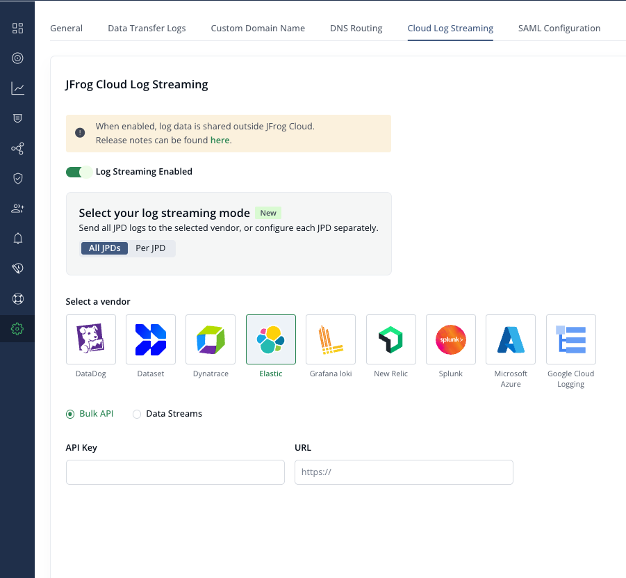
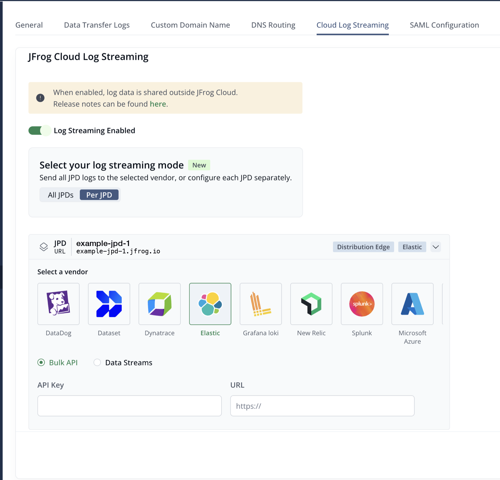

## Set up Cloud Log Streaming with Elastic Bulk API

Perform the following steps to set up log streaming with Elastic.

1. Generate a new API key in [Elastic](https://www.elastic.co/guide/en/kibana/current/api-keys.html).
   Api key should have following privileges:
```
"write",
"auto_configure",
"create_index",
"manage"
```

2. Go to the [MyJFrog Portal](http://my.jfrog.com/).

3. Additionally, you can access the MyJFrog Portal from the JFrog Platform. For more information, see [Platform Single Sign-On to MyJFrog](https://jfrog.com/help/r/5H19DEVA7PsahAXH0xXNSg/_iPFuW3rDQk_mlAk9URBkQ).

> Note: You must be a Platform Admin to access the MyJFrog Portal via the JFrog Platform.

Log into the JFrog Platform, and in the left navigation bar of the **Application** module, click **MyJFrog Portal**.
This opens the **MyJFrog Portal** in a new tab in your browser.

4. Select **Settings** from the left navigation menu.

5. Select the **JFrog Cloud Log Streaming** tab.

6. Turn on the **Log Streaming** toggle.

> Note: If your account has the **Per JPD** feature, the **Select your log streaming mode** section appears below the toggle. If not, the vendor list appears there instead. Start at step 2 of **Option A**.

7. Choose **Option A** or **Option B**.

* **Option A: All JPDs** sends logs from every JPD to a single destination.
* **Option B: Per JPD** sends the logs of each JPD to its own destination. Different JPDs can use different vendors.

#### Option A: All JPDs

1. Select **All JPDs**.

2. Select **Elastic**.



3. Select **Bulk API**.

4. Enter the Elastic API key in the **API Key** field. Enter the log ingestion URL in the **URL** field, in the format `http://localhost:9200/_bulk?pretty`.

5. Click **Save**.

#### Option B: Per JPD

1. Select **Per JPD**.



2. Expand the JPD you want to configure.

3. Select **Elastic**.

4. Select **Bulk API**.

5. Enter the Elastic API key in the **API Key** field and the log ingestion URL in the **URL** field for this JPD.

6. Repeat steps 2–5 for each JPD you want to configure. Empty JPDs stay **Not configured**.

7. Click **Save All**.

> Note: If a JPD has a vendor but not all required fields, **Save All** stays disabled. Hover over **Save All** to see which JPDs need more information.

> Note: When you switch to **Per JPD**, MyJFrog fills each JPD that has no saved settings with the **All JPDs** settings. MyJFrog saves these values only when you click **Save All**. Check each JPD before you click **Save All**.

> [!WARNING]
> When you switch back to **All JPDs**, a **Switch to All JPDs?** dialog appears if any JPD has its own settings. To continue, select the confirmation checkbox and click **Discard & switch**. MyJFrog then permanently deletes the per-JPD settings.

#### Log destination in Elastic

Logs will be streamed to a new Elastic index `jfrog_cloud`. No further log parsing in Elastic is provided by JFrog.
Index customization will be added later in the MyJFrog UI. 