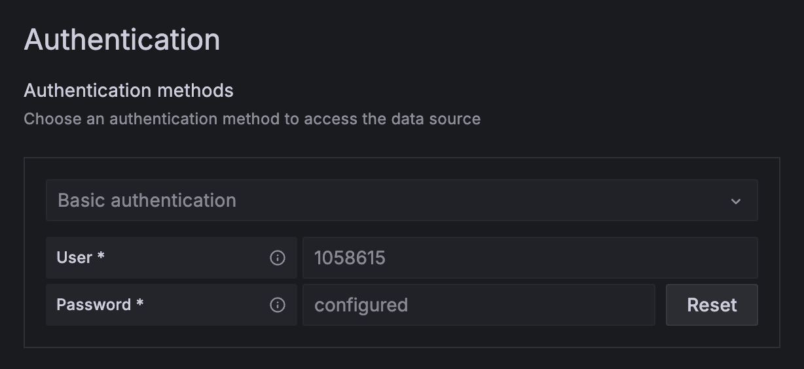
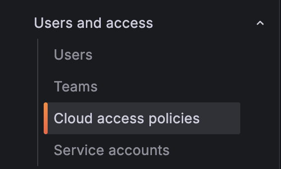
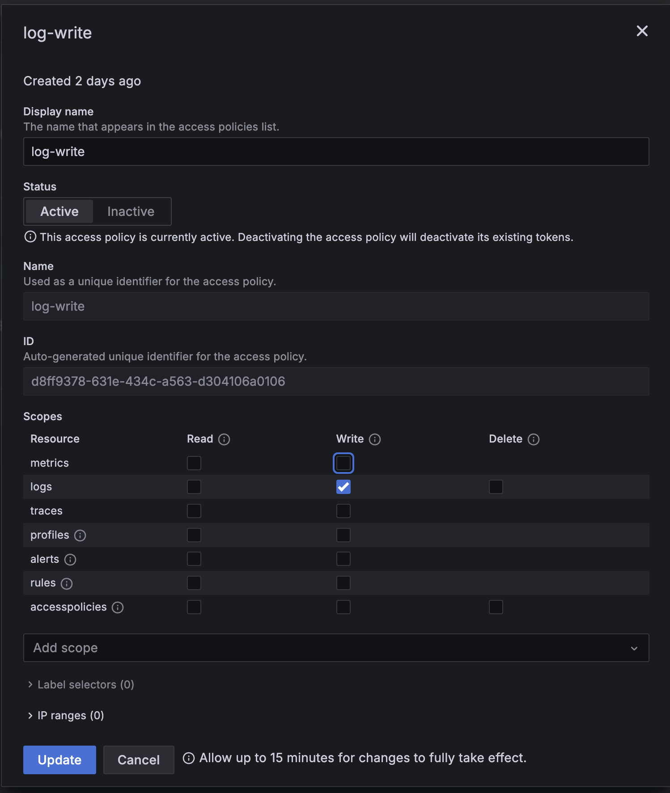
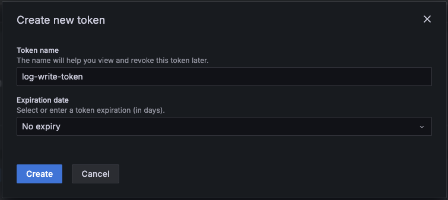
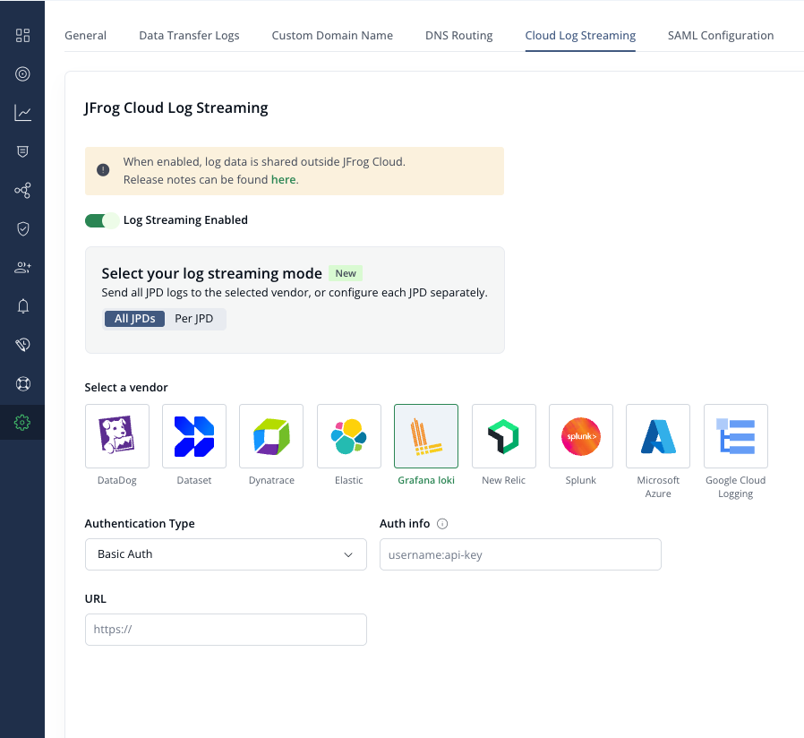
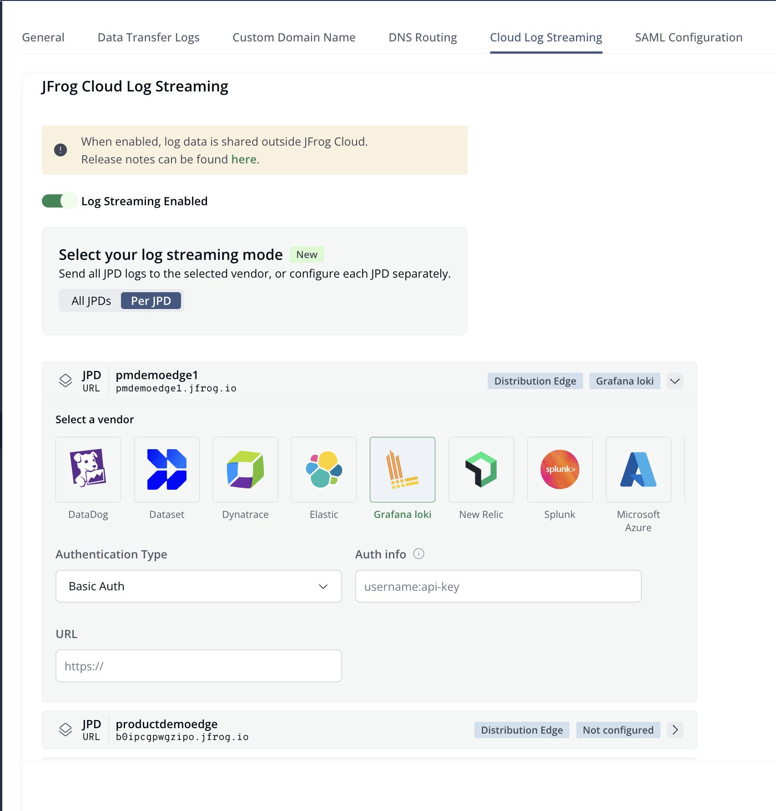

## Set up Cloud Log Streaming with Grafana Loki

Perform the following steps to set up log streaming with Grafana Loki.

1. Create Loki Datasource if self-hosted Grafana is used. The Loki Datasource is created by default in the cloud version. Only basic authentication is supported at the moment.

2. **Cloud version**: create a new Cloud access policy with **write** logs permissions.

Generate API token for this policy.

3. **Self-hosted version**: create API key for your Loki user.
4. Go to the [MyJFrog Portal](http://my.jfrog.com/).
5. Additionally, you can access the MyJFrog Portal from the JFrog Platform. For more information, see [Platform Single Sign-On to MyJFrog](https://jfrog.com/help/r/5H19DEVA7PsahAXH0xXNSg/_iPFuW3rDQk_mlAk9URBkQ).

> Note: You must be a Platform Admin to access the MyJFrog Portal via the JFrog Platform.

Log into the JFrog Platform, and in the left navigation bar of the **Application** module, click **MyJFrog Portal**.
This opens the **MyJFrog Portal** in a new tab in your browser.

6. Select **Settings** from the left navigation menu.

7. Select the **JFrog Cloud Log Streaming** tab.

8. Turn on the **Log Streaming** toggle.

> Note: If your account has the **Per JPD** feature, the **Select your log streaming mode** section appears below the toggle. If not, the vendor list appears there instead. Start at step 2 of **Option A**.

9. Choose **Option A** or **Option B**.

* **Option A: All JPDs** sends logs from every JPD to a single destination.
* **Option B: Per JPD** sends the logs of each JPD to its own destination. Different JPDs can use different vendors.

#### Option A: All JPDs

1. Select **All JPDs**.

2. Select **Grafana loki**.

3. Set **Authentication Type** to **Basic Auth**.

4. Enter `username:API_key` in the **Auth info** field and the Loki URL in the **URL** field. Loki URL and username can be found in the Loki Datasource settings, in the Connection and Authentication sections.

5. Click **Save**.

#### Option B: Per JPD

1. Select **Per JPD**.

2. Expand the JPD you want to configure.

3. Select **Grafana loki**.

4. Set **Authentication Type** to **Basic Auth**.

5. Enter `username:API_key` in the **Auth info** field and the Loki URL in the **URL** field for this JPD.

6. Repeat steps 2–5 for each JPD you want to configure. Empty JPDs stay **Not configured**.

7. Click **Save All**.

> Note: If a JPD has a vendor but not all required fields, **Save All** stays disabled. Hover over **Save All** to see which JPDs need more information.

> Note: When you switch to **Per JPD**, MyJFrog fills each JPD that has no saved settings with the **All JPDs** settings. MyJFrog saves these values only when you click **Save All**. Check each JPD before you click **Save All**.

> [!WARNING]
> When you switch back to **All JPDs**, a **Switch to All JPDs?** dialog appears if any JPD has its own settings. To continue, select the confirmation checkbox and click **Discard & switch**. MyJFrog then permanently deletes the per-JPD settings.
