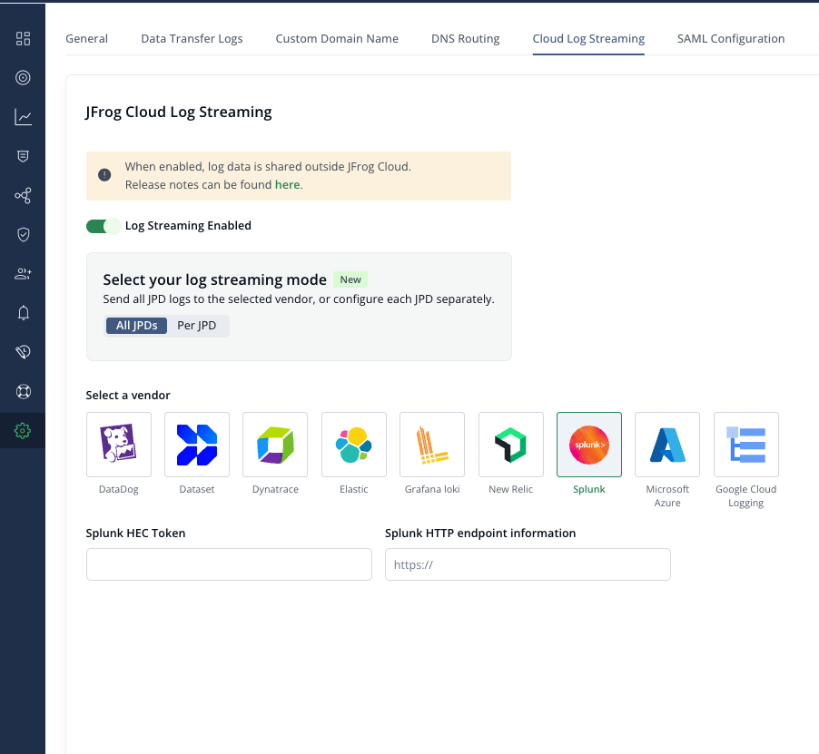
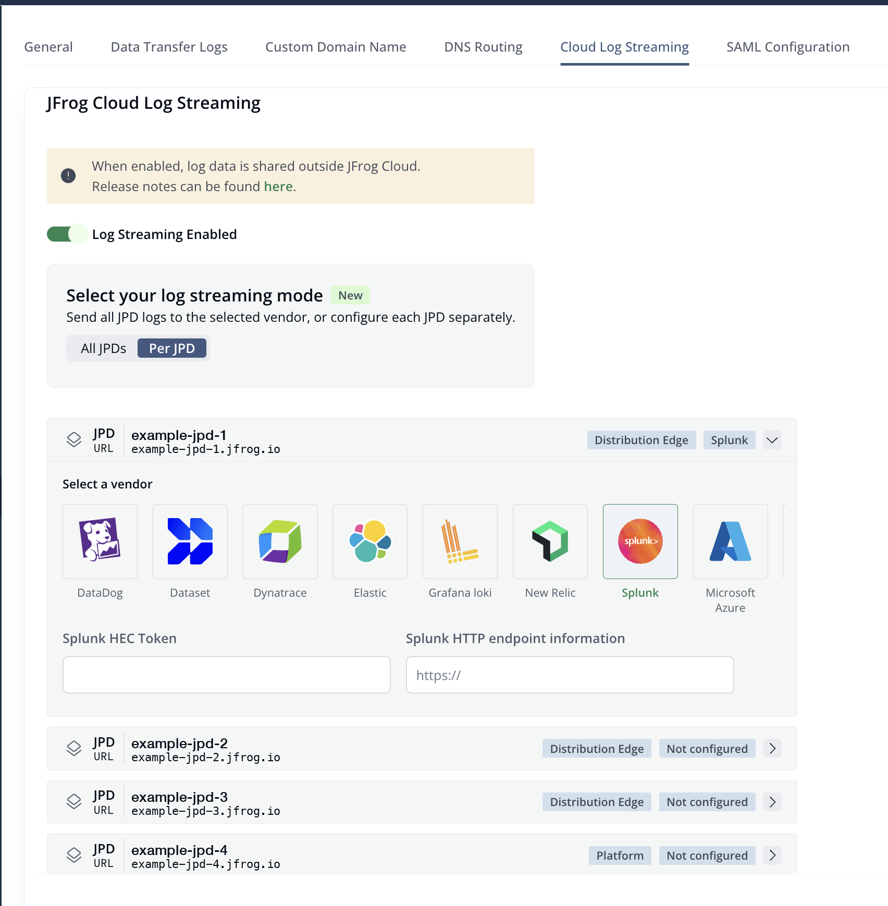

## Set up Cloud Log Streaming with Splunk

Perform the following steps to set up log streaming with Splunk.

1. If you have any firewall restrictions, whitelist your Artifactory region from this list. See the [official documentation](https://jfrog.com/help/r/what-are-artifactory-cloud-nated-ips/what-are-artifactory-cloud-nated-ips) for the reference.

2. Whitelist the following IPs for the management region:

```
52.206.165.145/32
3.218.212.121/32
3.95.51.114/32
3.216.224.216/32
```

3. In Splunk, generate the Splunk HEC token in **Settings > Data Inputs > HTTP Event Collector > Tokens**. For more information, see [Splunk Documentation](https://docs.splunk.com/Documentation/SplunkCloud/9.1.2308/Data/UsetheHTTPEventCollector#Configure_HTTP_Event_Collector_on_Splunk_Cloud_Platform).

4. Fetch the Splunk URL in the following format: `{hostname}/services/collector`

5. Go to the [MyJFrog Portal](http://my.jfrog.com/).

6. Additionally, you can access the MyJFrog Portal from the JFrog Platform. For more information, see [Platform Single Sign-On to MyJFrog](https://jfrog.com/help/r/5H19DEVA7PsahAXH0xXNSg/_iPFuW3rDQk_mlAk9URBkQ).

> Note: You must be a Platform Admin to access the MyJFrog Portal via the JFrog Platform.

Log into the JFrog Platform, and in the left navigation bar of the **Application** module, click **MyJFrog Portal**.
This opens the **MyJFrog Portal** in a new tab in your browser.

7. Select **Settings** from the left navigation menu.

8. Select the **JFrog Cloud Log Streaming** tab.

9. Turn on the **Log Streaming** toggle.

> Note: If your account has the **Per JPD** feature, the **Select your log streaming mode** section appears below the toggle. If not, the vendor list appears there instead. Start at step 2 of **Option A**.

10. Choose **Option A** or **Option B**.

* **Option A: All JPDs** sends logs from every JPD to a single destination.
* **Option B: Per JPD** sends the logs of each JPD to its own destination. Different JPDs can use different vendors.

#### Option A: All JPDs

1. Select **All JPDs**.

2. Select **Splunk**.



3. Enter the HEC token in the **Splunk HEC Token** field.

4. Enter the Splunk URL in the **Splunk HTTP endpoint information** field.

5. Click **Save**.

#### Option B: Per JPD

1. Select **Per JPD**.



2. Expand the JPD you want to configure.

3. Select **Splunk**.

4. Enter the **Splunk HEC Token** and the **Splunk HTTP endpoint information** for this JPD.

5. Repeat steps 2–4 for each JPD you want to configure. Empty JPDs stay **Not configured**.

6. Click **Save All**.

> Note: If a JPD has a vendor but not all required fields, **Save All** stays disabled. Hover over **Save All** to see which JPDs need more information.

> Note: When you switch to **Per JPD**, MyJFrog fills each JPD that has no saved settings with the **All JPDs** settings. MyJFrog saves these values only when you click **Save All**. Check each JPD before you click **Save All**.

> [!WARNING]
> When you switch back to **All JPDs**, a **Switch to All JPDs?** dialog appears if any JPD has its own settings. To continue, select the confirmation checkbox and click **Discard & switch**. MyJFrog then permanently deletes the per-JPD settings.
